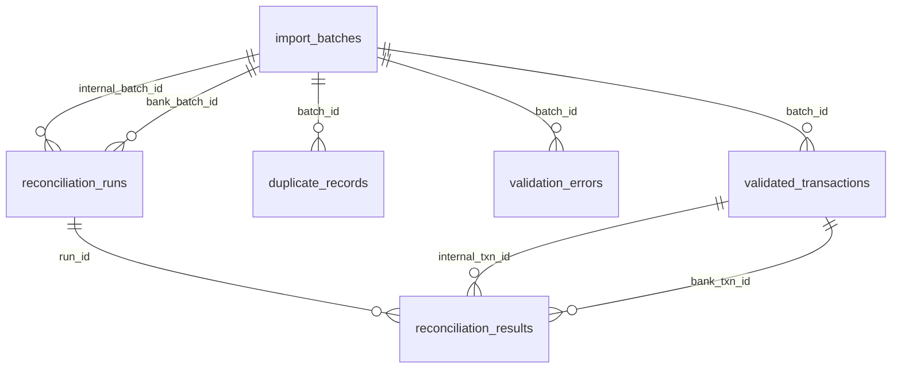

# LedgerLens

**Financial transaction reconciliation toolkit, SQLite storage engine, and Streamlit dashboard** — a project for learning Python, database design, and financial engineering fundamentals.

> [!NOTE]
> **Scope & Purpose**: LedgerLens performs **transaction-level reconciliation**—matching individual ledger line items against bank statement lines and itemizing timing, conflict, and missing-record variances. It is **not** a full general ledger account-balance reconciliation system (which tracks opening/closing balances, continuous account roll-forwards, or chart of accounts trial balances) nor a production banking backend.

---

## Table of Contents

- [What It Does](#what-it-does)
- [Milestones Implemented](#milestones-implemented)
- [Installation](#installation)
- [Quick Start & Run Commands](#quick-start--run-commands)
  - [1. Launch Interactive Streamlit Dashboard (Milestone 3)](#1-launch-interactive-streamlit-dashboard-milestone-3)
  - [2. Run the Command-Line Pipeline (Milestones 1 & 2)](#2-run-the-command-line-pipeline-milestones-1--2)
  - [3. Inspect Batches via CLI](#3-inspect-batches-via-cli)
- [How the Streamlit Dashboard Calls Existing Python Code](#how-the-streamlit-dashboard-calls-existing-python-code)
- [Running Tests](#running-tests)
- [Project Architecture](#project-architecture)
- [Database Schema (Milestone 2)](#database-schema-milestone-2)
- [Core Database Concepts Explained](#core-database-concepts-explained)
  - [1. Primary Keys (PK)](#1-primary-keys-pk)
  - [2. Foreign Keys (FK) & Referential Integrity](#2-foreign-keys-fk--referential-integrity)
  - [3. SQL JOINs (Left Outer vs Inner)](#3-sql-joins-left-outer-vs-inner)
  - [4. GROUP BY & Conditional Aggregation](#4-group-by--conditional-aggregation)
  - [5. Database Transactions & Atomicity](#5-database-transactions--atomicity)
- [Why Integer Cents (Never SQLite REAL)?](#why-integer-cents-never-sqlite-real)
- [Example SQL Queries](#example-sql-queries)
- [Output Files](#output-files)
- [Assumptions & Limitations](#assumptions--limitations)

---

## What It Does

In financial operations, a company records transactions in an **internal ledger** (e.g., ERP or billing system), while the bank issues a **bank statement**. Because of timing differences, data-entry errors, bank fees, and processing quirks, the two sets of records rarely balance on the surface.

**LedgerLens**:
1. Ingests raw internal and bank CSV files.
2. Validates fields row-by-row (catching bad dates, missing values, malformed amounts, fractional cents).
3. Identifies and isolates duplicate transaction IDs so they never corrupt reconciliation.
4. Stores transactions in SQLite using **integer cents** (never floating point) with complete source tracing.
5. Reconciles records across datasets and flags **exact matches**, **amount conflicts**, and **one-sided unmatched transactions**.
6. Generates pure SQL reports that **algebraically prove** why internal cash movement differs from bank cash movement down to the exact cent.
7. Delivers an interactive local **Streamlit dashboard** (`app.py`) for visual inspection, batch selection, searching, charting, and report downloads.

---

## Milestones Implemented

- **Milestone 1**: CSV loading, row-level validation, duplicate detection, exact matching algorithm, cash-movement summaries, and CSV/text reporting. (Python standard library only).
- **Milestone 2**: SQLite storage, integer cents validation, idempotent SHA-256 batch imports, batch selection, atomic transactions, and SQL reporting.
- **Milestone 3**: Local Streamlit dashboard (`app.py`), upload/sample ingestion, row-level error previews, interactive batch selection, manual reconciliation trigger, KPI status cards distinguishing "Net Cash Movements Equal" from "Difference fully explained", searchable result tables, monthly inflow/outflow charts with "Excluded Duplicate Records", and CSV/report downloads.

---

## Installation

LedgerLens uses the standard library for all core parsing, validation, database, and reconciliation logic. The interactive dashboard requires Streamlit:

```bash
# Optional: create and activate a virtual environment
python -m venv .venv
.venv\Scripts\activate       # On Windows (or source .venv/bin/activate on Linux/macOS)

# Install requirements
pip install -r requirements.txt
# or install directly:
pip install streamlit
```

---

## Quick Start & Run Commands

### 1. Launch Interactive Streamlit Dashboard (Milestone 3)
```bash
python -m streamlit run app.py
```
This opens the browser dashboard at `http://localhost:8501`. From the dashboard, you can:
- Ingest the fictional sample data or upload your own CSV files.
- Inspect validation errors and quarantined duplicates before reconciling.
- Select explicit internal and bank batches by ID and timestamp.
- Click **"Run Reconciliation"** to execute matching on-demand without unintended rerun triggers.
- Filter and search matches, conflicts, and unmatched transactions by ID or description.
- View monthly inflow/outflow charts for selected batches.
- Download full reconciliation CSVs and summary reports.

### 2. Run the Command-Line Pipeline (Milestones 1 & 2)
```bash
python main.py
```
This runs the full CLI pipeline: loads sample data, stores it in SQLite, runs reconciliation, verifies database figures match Milestone 1 hand-calculated values, and exports reports to `output/`.

### 3. Inspect Batches via CLI
```bash
python main.py --list-batches
```
Example output:
```text
============================================================
  LedgerLens - Imported Batches in SQLite
============================================================
  Batch #1: side=internal file='internal_transactions.csv' imported_at=2026-10-18T23:45:47... hash=948812755d...
  Batch #2: side=bank file='bank_transactions.csv' imported_at=2026-10-18T23:45:47... hash=2eb5d421f5...
============================================================
```

### 3. Reconcile Specific Batches
If multiple batches have been imported over time, you can explicitly choose which internal and bank batch to reconcile:
```bash
python main.py --internal-batch 1 --bank-batch 2
```

### 4. Custom Database or CSV Paths
```bash
python main.py --db staging.db --internal path/to/internal.csv --bank path/to/bank.csv
```

---

---

## How the Streamlit Dashboard Calls Existing Python Code

The Streamlit dashboard (`app.py`) serves as a visual, reactive user interface layered directly over the core Python engine without altering any business logic or financial algorithms:

```
┌─────────────────────────────────────────────────────────────┐
│                    Streamlit UI (app.py)                     │
│  - File Uploaders & Sample Loaders                          │
│  - Explicit Batch Selection Dropdowns                       │
│  - Reactive Search Filter & Tab Views                       │
│  - Inflow/Outflow Visualizations                            │
│  - CSV & Text Report Download Buttons                       │
└──────────────────────────────┬──────────────────────────────┘
                               │
            Calls on-demand via user action
                               │
                               ▼
┌─────────────────────────────────────────────────────────────┐
│                 Core LedgerLens Engine                      │
│                                                             │
│  1. Ingestion & Validation:                                 │
│     ledgerlens.database.import_csv_to_db()                  │
│       └─ calls ledgerlens.loader.load_csv()                 │
│       └─ calls ledgerlens.loader.find_duplicates()          │
│       └─ calls ledgerlens.database.decimal_to_cents()       │
│                                                             │
│  2. Reconciliation Engine:                                  │
│     ledgerlens.database.reconcile_batches_in_db()           │
│       └─ indexes bank rows by (transaction_id, currency)    │
│       └─ computes exact matches, conflicts, and unmatched   │
│       └─ writes run record and results atomically           │
│                                                             │
│  3. SQL Reporting & Proofs:                                 │
│     ledgerlens.sql_reports.get_reconciliation_overview()     │
│       └─ computes algebraic proof: Net Diff == Explained    │
│     ledgerlens.sql_reports.get_monthly_cash_movements()     │
│       └─ groups accepted movements vs excluded duplicates   │
│     ledgerlens.sql_reports.get_amount_conflicts()           │
│       └─ traces row numbers & descriptions via LEFT JOIN    │
│     ledgerlens.sql_reports.get_data_quality_summary()       │
│       └─ counts accepted, duplicate, and error records      │
│                                                             │
│  4. Export Artifacts:                                       │
│     ledgerlens.reporter.build_summary_text()                │
│     ledgerlens.sql_reports.format_sql_reports_text()        │
└─────────────────────────────────────────────────────────────┘
```

1. **Ingestion & Validation**:
   When the user clicks **"Import Sample Data"** or **"Import Uploaded Files"**, `app.py` calls `import_csv_to_db()`. This function parses rows with `load_csv()`, catches invalid dates, malformed amounts, or fractional cents into `validation_errors`, separates repeated IDs with `find_duplicates()`, and atomically writes to SQLite using integer cents.
2. **Batch Selection & Metadata**:
   `app.py` queries `get_batches(conn, "internal")` and `get_batches(conn, "bank")` to populate selectboxes with batch IDs, source filenames, and import timestamps.
3. **On-Demand Reconciliation**:
   Reconciliation only executes when the user clicks **"Run Reconciliation"**. `app.py` calls `reconcile_batches_in_db(conn, int_batch_id, bank_batch_id)`, storing the resulting `run_id` in `st.session_state`. This guarantees that Streamlit reruns (such as table searching or chart interaction) never duplicate batches or runs.
4. **Financial Verification & Display**:
   `app.py` calls `get_reconciliation_overview(conn, run_id)` to evaluate:
   - **Net Cash Movements Equal?** Checks if raw internal cash net equals bank cash net (`net_difference == Decimal("0.00")`).
   - **Difference fully explained?** Verifies the algebraic proof that conflicts and unmatched items account for 100% of the net variance.
5. **Chart Transformation**:
   Monthly cash movement figures are fetched via `get_monthly_cash_movements(conn, batch_ids)`. Mathematical integrity is preserved in Decimal/cents; values are cast to float only at the moment of chart plotting. Excluded duplicates are charted and flagged under **"Excluded Duplicate Records"**, distinct from confirmed cash movements.

---

## Running Tests

LedgerLens maintains 59 comprehensive unit and integration tests across all modules:

```bash
# Run tests using the project virtual environment or system Python
python -m unittest discover -s tests -v
```

The test suite covers:
- **`test_loader.py`**: CSV parsing, header checks, date/amount validation, fractional cent detection, duplicate detection (14 tests).
- **`test_reconciler.py`**: Matching logic, cash summaries, conflict detection, algebraic difference proofs (17 tests).
- **`test_reporter.py`**: File export structure, column headers, difference fully explained assertion (8 tests).
- **`test_database.py`**: Integer cents conversions, fractional cent rejection, non-finite rejection, idempotent SHA-256 hashing, atomic rollback on database failure, row-level validation error persistence, foreign-key tracing, and verification against Milestone 1 numbers (13 tests).
- **`test_sql_reports.py`**: Monthly cash movements (accepted vs excluded), unmatched counts and signed totals, amount conflicts with row-level tracing, data quality metrics, and SQL algebraic proof (5 tests).
- **`test_dashboard_integration.py`**: Streamlit dashboard backend queries, metadata tracing, search filtering logic, Decimal preservation during chart prep, and separation of "Net Cash Movements Equal" from "Difference fully explained" (7 tests).

---

## Project Architecture

```
ledgerlens/
├── data/                          Source CSV datasets (never modified)
│   ├── internal_transactions.csv  Internal ERP ledger (10 rows: 8 valid, 2 invalid)
│   └── bank_transactions.csv      Bank statement (11 rows: 9 valid, 2 invalid)
├── ledgerlens/                    Python package
│   ├── __init__.py                Package exports and docstring
│   ├── models.py                  Data classes (Transaction, ValidationError, LoadResult)
│   ├── loader.py                  CSV parsing, row-level validation, duplicate detection
│   ├── reconciler.py              Matching logic, cash movement computation
│   ├── reporter.py                CSV and plain-text file exporters
│   ├── database.py                SQLite schema, integer-cents conversions, atomic batch imports
│   └── sql_reports.py             Parameterized SQL reports and algebraic reconciliation proof
├── tests/                         Automated test suite (59 tests)
│   ├── __init__.py
│   ├── test_loader.py
│   ├── test_reconciler.py
│   ├── test_reporter.py
│   ├── test_database.py
│   ├── test_sql_reports.py
│   └── test_dashboard_integration.py
├── output/                        Generated reports and exports
│   ├── matched.csv
│   ├── conflicts.csv
│   ├── unmatched_internal.csv
│   ├── unmatched_bank.csv
│   ├── duplicates_internal.csv
│   ├── duplicates_bank.csv
│   ├── invalid_internal.csv
│   ├── invalid_bank.csv
│   ├── summary.txt
│   └── sql_report.txt
├── app.py                         Interactive Streamlit dashboard (Milestone 3)
├── main.py                        Command-line entry point (Milestones 1 & 2)
├── requirements.txt               Dependencies (streamlit and supporting libraries)
└── README.md                      Project documentation & educational guide
```

---

## Database Schema (Milestone 2)

LedgerLens implements six normalized tables in SQLite with full referential integrity (`PRAGMA foreign_keys = ON`):



### Table Details

1. **`import_batches`**
   - Tracks file ingestion metadata.
   - Columns: `id` (PK), `dataset_side` ('internal' | 'bank'), `source_filename`, `file_hash` (SHA-256), `imported_at`.
   - Constraint: `UNIQUE(dataset_side, file_hash)` guarantees that re-importing an identical file is a safe, idempotent no-op.

2. **`validated_transactions`**
   - Stores transactions that passed row-level validation and are unique within their batch.
   - Columns: `id` (PK), `batch_id` (FK), `dataset_side`, `source_filename`, `source_row`, `transaction_id`, `date`, `description`, `amount_cents` (INTEGER), `currency`.

3. **`duplicate_records`**
   - Stores rows whose `transaction_id` appeared more than once in the source file.
   - Columns: Same schema as `validated_transactions`. Excluded from reconciliation so duplicates never distort financial figures.

4. **`validation_errors`**
   - Stores raw row data and error messages for rows that failed field-level validation (e.g. invalid dates, non-numeric amounts).
   - Columns: `id` (PK), `batch_id` (FK), `dataset_side`, `source_filename`, `source_row`, `raw_data_json`, `errors`.

5. **`reconciliation_runs`**
   - Records each reconciliation event connecting an internal batch to a bank batch.
   - Columns: `id` (PK), `internal_batch_id` (FK), `bank_batch_id` (FK), `reconciled_at`.

6. **`reconciliation_results`**
   - Stores the outcome for each transaction compared during a run.
   - Columns: `id` (PK), `run_id` (FK), `category` ('matched' | 'conflict' | 'unmatched_internal' | 'unmatched_bank'), `transaction_id`, `currency`, `internal_txn_id` (FK to `validated_transactions.id`), `bank_txn_id` (FK to `validated_transactions.id`), `internal_amount_cents`, `bank_amount_cents`, `difference_cents`.

---

## Core Database Concepts Explained

### 1. Primary Keys (PK)
A **Primary Key** is a column (or set of columns) that uniquely identifies each row in a database table. No two rows can have the same primary key, and a primary key value can never be `NULL`.

**In LedgerLens:**
```sql
CREATE TABLE import_batches (
    id INTEGER PRIMARY KEY AUTOINCREMENT,
    ...
);
```
Every table uses an integer surrogate key (`id`). This allows us to unambiguously reference a specific batch, transaction, or reconciliation result, even if two transactions share the same business identifier (`transaction_id`).

### 2. Foreign Keys (FK) & Referential Integrity
A **Foreign Key** is a column that establishes a direct link between data in two tables by referencing the Primary Key of another table.

**In LedgerLens:**
```sql
CREATE TABLE validated_transactions (
    id INTEGER PRIMARY KEY AUTOINCREMENT,
    batch_id INTEGER NOT NULL REFERENCES import_batches(id) ON DELETE CASCADE,
    ...
);
```
- `batch_id` ensures that every transaction is attached to a real, valid batch.
- `ON DELETE CASCADE` ensures that if a batch is deleted, all of its associated transactions are automatically cleaned up, preventing "orphaned" rows.
- In `reconciliation_results`, `internal_txn_id` and `bank_txn_id` reference `validated_transactions(id)`:
```sql
internal_txn_id INTEGER REFERENCES validated_transactions(id) ON DELETE SET NULL
```
This enables tracing any reconciliation line directly back to its exact input row, source CSV filename, and date.

### 3. SQL JOINs (Left Outer vs Inner)
A **JOIN** combines rows from two or more tables based on a related column between them.
- An **INNER JOIN** only returns rows when there is a match in *both* tables.
- A **LEFT OUTER JOIN** (or simply `LEFT JOIN`) returns all rows from the left table, and the matched rows from the right table (filling in `NULL` if there is no match).

**Why LedgerLens uses LEFT JOIN:**
In `reconciliation_results`, unmatched transactions only exist on one side: an `unmatched_internal` transaction has `internal_txn_id`, but `bank_txn_id` is `NULL`. If we used `INNER JOIN`, all unmatched transactions would be silently erased from the report!
```sql
SELECT
    r.category,
    r.transaction_id,
    it.source_row AS internal_row,
    bt.source_row AS bank_row
FROM reconciliation_results r
LEFT JOIN validated_transactions it ON r.internal_txn_id = it.id
LEFT JOIN validated_transactions bt ON r.bank_txn_id = bt.id
WHERE r.run_id = ?;
```
Using `LEFT JOIN` preserves all rows from `reconciliation_results` while pulling in row numbers and descriptions from either side when present.

### 4. GROUP BY & Conditional Aggregation
`GROUP BY` collapses multiple rows into summary rows based on shared values, allowing aggregate functions (`COUNT`, `SUM`, `AVG`) to compute values per group.

**In LedgerLens:**
To calculate monthly cash movements, we group by dataset side and month:
```sql
SELECT
    dataset_side,
    SUBSTR(date, 1, 7) AS month,
    COUNT(*) AS txn_count,
    SUM(CASE WHEN amount_cents > 0 THEN amount_cents ELSE 0 END) AS inflows_cents,
    SUM(CASE WHEN amount_cents < 0 THEN amount_cents ELSE 0 END) AS outflows_cents,
    SUM(amount_cents) AS net_cents
FROM validated_transactions
GROUP BY dataset_side, SUBSTR(date, 1, 7);
```
- `SUBSTR(date, 1, 7)` extracts the year and month (e.g. `'2026-03'`) from the ISO date `'2026-03-15'`.
- `CASE WHEN ... THEN ... ELSE 0 END` performs **conditional aggregation**, splitting positive amounts into `inflows` and negative amounts into `outflows` in a single pass.
- We run this query across `validated_transactions` (accepted) and `duplicate_records` (excluded) with `UNION ALL`, clearly distinguishing accepted money from excluded money.

### 5. Database Transactions & Atomicity
A **database transaction** is a sequence of database operations treated as a single indivisible unit of work. Transactions follow the **ACID** properties:
- **Atomicity**: Either all operations succeed, or none do ("all-or-nothing").
- **Consistency**: The database moves from one valid state to another, satisfying all constraints.
- **Isolation**: Concurrent transactions cannot see each other's partial modifications.
- **Durability**: Once committed, changes survive system crashes.

**In LedgerLens:**
When importing a file, we insert into `import_batches`, `validated_transactions`, `duplicate_records`, and `validation_errors`. If a CSV contains 1,000 valid rows and row 1,001 fails (e.g., contains fractional cents), committing a partial batch would corrupt accounting records.

Python's `sqlite3` context manager provides atomic execution:
```python
with conn:
    cursor.execute("INSERT INTO import_batches ...")
    batch_id = cursor.lastrowid
    cursor.executemany("INSERT INTO validated_transactions ...", validated_rows)
    cursor.executemany("INSERT INTO duplicate_records ...", duplicate_rows)
    cursor.executemany("INSERT INTO validation_errors ...", error_rows)
```
If any exception occurs inside the `with conn:` block, SQLite automatically executes `ROLLBACK`, restoring the database to its exact prior state. If the block completes without errors, SQLite automatically issues `COMMIT`.

---

## Why Integer Cents (Never SQLite REAL)?

Computers represent floating-point numbers (`REAL` in SQLite, `float` in Python) using IEEE 754 binary fractions. Most decimal fractions cannot be represented exactly in binary:
```python
>>> 0.10 + 0.20
0.30000000000000004
```
In finance, rounding errors compound over thousands of transactions, creating discrepancies in audits.

**The LedgerLens Strategy:**
1. **Python Layer**: Use `decimal.Decimal` for exact decimal representation during parsing and arithmetic.
2. **Validation**: Check `decimal_to_cents(amount: Decimal)`:
   - Verify `amount.is_finite()` (reject `NaN`, `Infinity`).
   - Check for fractional cents (`amount * 100 == (amount * 100).to_integral_value()`). If someone passes `$10.005`, it is **rejected with an error** rather than silently rounded!
3. **Database Layer**: Store amounts as `INTEGER` representing cents (e.g. `$100.50` is stored as `10050`).
4. **Display**: Convert back using `cents_to_decimal(cents: int) -> Decimal`, quantizing to 2 decimal places.

---

## Example SQL Queries

Here are actual SQL queries implemented in `ledgerlens/sql_reports.py` that you can run directly against `ledgerlens.db`:

### 1. Monthly Cash Movements (Accepted vs Excluded)
```sql
SELECT
    dataset_side,
    SUBSTR(date, 1, 7) AS month,
    'accepted' AS record_status,
    COUNT(*) AS txn_count,
    SUM(CASE WHEN amount_cents > 0 THEN amount_cents ELSE 0 END) / 100.0 AS inflows_usd,
    SUM(CASE WHEN amount_cents < 0 THEN amount_cents ELSE 0 END) / 100.0 AS outflows_usd,
    SUM(amount_cents) / 100.0 AS net_usd
FROM validated_transactions
GROUP BY dataset_side, SUBSTR(date, 1, 7)

UNION ALL

SELECT
    dataset_side,
    SUBSTR(date, 1, 7) AS month,
    'excluded_duplicate' AS record_status,
    COUNT(*) AS txn_count,
    SUM(CASE WHEN amount_cents > 0 THEN amount_cents ELSE 0 END) / 100.0 AS inflows_usd,
    SUM(CASE WHEN amount_cents < 0 THEN amount_cents ELSE 0 END) / 100.0 AS outflows_usd,
    SUM(amount_cents) / 100.0 AS net_usd
FROM duplicate_records
GROUP BY dataset_side, SUBSTR(date, 1, 7)
ORDER BY dataset_side, month, record_status;
```

### 2. Unmatched Transaction Totals by Dataset
```sql
SELECT
    category,
    CASE
        WHEN category = 'unmatched_internal' THEN 'internal'
        WHEN category = 'unmatched_bank' THEN 'bank'
    END AS dataset_side,
    COUNT(*) AS txn_count,
    SUM(COALESCE(internal_amount_cents, 0) + COALESCE(bank_amount_cents, 0)) / 100.0 AS total_usd
FROM reconciliation_results
WHERE run_id = 1 AND category IN ('unmatched_internal', 'unmatched_bank')
GROUP BY category;
```

### 3. Amount Conflicts with Row Tracing
```sql
SELECT
    r.transaction_id,
    r.internal_amount_cents / 100.0 AS internal_usd,
    r.bank_amount_cents / 100.0 AS bank_usd,
    r.difference_cents / 100.0 AS diff_usd,
    it.source_row AS internal_row,
    bt.source_row AS bank_row
FROM reconciliation_results r
LEFT JOIN validated_transactions it ON r.internal_txn_id = it.id
LEFT JOIN validated_transactions bt ON r.bank_txn_id = bt.id
WHERE r.run_id = 1 AND r.category = 'conflict';
```

### 4. Data Quality Counts (Accepted vs Duplicates vs Errors)
```sql
SELECT
    b.id AS batch_id,
    b.dataset_side,
    b.source_filename,
    (SELECT COUNT(*) FROM validated_transactions vt WHERE vt.batch_id = b.id) AS accepted_count,
    (SELECT COUNT(*) FROM duplicate_records dr WHERE dr.batch_id = b.id) AS duplicate_count,
    (SELECT COUNT(*) FROM validation_errors ve WHERE ve.batch_id = b.id) AS invalid_count
FROM import_batches b;
```

---

## Output Files

Every run populates the `output/` directory:

| File | Format | Description |
|---|---|---|
| `matched.csv` | CSV | Side-by-side view of transactions agreeing on ID, currency, and amount. |
| `conflicts.csv` | CSV | Transactions sharing ID & currency but differing in amount (shows both amounts and difference). |
| `unmatched_internal.csv` | CSV | Transactions recorded in internal ledger but missing from bank statement. |
| `unmatched_bank.csv` | CSV | Transactions on bank statement with no corresponding internal ledger entry. |
| `duplicates_internal.csv` | CSV | Rows with repeated IDs in internal ledger (all copies excluded from matching). |
| `duplicates_bank.csv` | CSV | Rows with repeated IDs in bank statement (all copies excluded from matching). |
| `invalid_internal.csv` | CSV | Internal rows that failed validation (preserves raw strings and error messages). |
| `invalid_bank.csv` | CSV | Bank rows that failed validation (preserves raw strings and error messages). |
| `summary.txt` | Text | Human-readable reconciliation narrative with algebraic proof and Difference fully explained status. |
| `sql_report.txt` | Text | Pure SQL aggregation report covering data quality, monthly cash movements, unmatched totals, and SQL algebraic proof. |

---

## Assumptions & Limitations

1. **Transaction-Level Scope (Not Full Account-Balance or Core Banking)**:
   - LedgerLens is a **transaction reconciliation engine** designed to match granular transactions between two input files and prove why cash movements differ.
   - It is **not** a general ledger account-balance reconciliation system: it does not maintain opening/closing ledger balances, double-entry trial balances, journal entry adjustments, or bank statement running balances.
   - It is **not** a production core banking system: it does not handle real-time payment rails (ACH/Fedwire/SEPA), transaction processing queues, or multi-tenant user access control.
2. **Exact 1-to-1 Matching Key**: Matches transactions on `(transaction_id, currency, amount)`. Many-to-one (e.g., one lump-sum deposit matching three customer invoices) is out of scope for this milestone.
3. **USD Currency Only**: All amounts are parsed as USD and stored as integer cents. Multi-currency conversions and FX gain/loss adjustments are reserved for future work.
4. **Descriptions and Dates Ignored for Matching**: Banks routinely truncate memos and post transactions with a 1-3 day settlement delay. Dollar amounts and unique transaction IDs provide the primary matching key.
5. **Duplicate Exclusion**: When an ID appears multiple times within a single file, all instances are quarantined into `duplicate_records`. We cannot guess which transaction is valid.
6. **Local Deployment**: The dashboard is a local Streamlit application (`app.py`) for analyst use, designed to run locally over a shared SQLite database. Cloud hosting and remote database engines are out of scope.

---

## Dashboard Visual Layout

```text
┌────────────────────────────────────────────────────────────────────────┐
│  LEDGERLENS — TRANSACTION RECONCILIATION DASHBOARD                     │
├───────────────────┬────────────────────────────────────────────────────┤
│ SIDEBAR           │ MAIN CONTENT                                       │
│ 1. Ingestion:     │ Section A: Pre-Reconciliation Data Quality         │
│    [Sample Data]  │ - Validation Errors (e.g. fractional cents, dates) │
│    [Upload CSVs]  │ - Quarantined Duplicate Records                    │
│ 2. Batch Selector │                                                    │
│    Internal Batch │ Section B: Financial Summary & Status              │
│    Bank Batch     │ ┌──────────────────────┬─────────────────────────┐ │
│ 3. Actions:       │ │ NET CASH MOVEMENTS   │ DIFFERENCE FULLY        │ │
│ [Run Reconciliation]│ EQUAL?               │ EXPLAINED?              │ │
│                   │ │ NO (Variance: $3,764)│ YES [OK] (Algebraic)    │ │
│                   │ └──────────────────────┴─────────────────────────┘ │
│                   │ Net Movements: Internal $15,943.18 | Bank $19,707.68│
│                   │ Counts: Matches (4) | Conflicts (1) | Unmatched (3)│
│                   │                                                    │
│                   │ Section C: Searchable Tables                       │
│                   │ [Search: TXN-001...]                               │
│                   │ [Matches] [Conflicts] [Unmatched Int] [Unmatched Bank]
│                   │                                                    │
│                   │ Section D: Monthly Cash Movement Visualizations    │
│                   │ - Bar chart: Inflows, Outflows, and               │
│                   │   Excluded Duplicate Records                       │
│                   │                                                    │
│                   │ Section E: Downloads                               │
│                   │ [SQL Report] [Matches CSV] [Conflicts] [Unmatched] │
└───────────────────┴────────────────────────────────────────────────────┘
```

